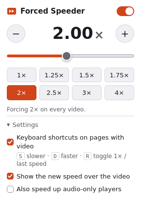
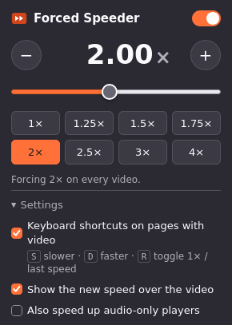

# Forced Speeder

A small, open-source Firefox extension that plays any HTML5 video at the speed
you choose, **including on sites that hide or lock the speed setting**. Edpuzzle
is the usual example: if the teacher hasn't enabled speed control, the player
won't let you change it. Forced Speeder changes it anyway.

<p>
  
  
</p>

- 0.25× to 16×: presets, a slider, +/− buttons, or type an exact value
- Works on videos inside iframes (YouTube embeds, the way Edpuzzle and LMSes
  show YouTube videos) and inside shadow DOM players
- The site can't undo it: resets and polling are ignored, and the site keeps
  reading its own speed (usually 1), so it doesn't notice the change
- At **1×** the extension stays out of the way and sites control their own speed
- Keyboard shortcuts **S** / **D** / **R** on pages with video
- No tracking, no network requests, no remote code. Only the `storage`
  permission, plus access to pages so it can reach their videos

## Install

### From a release (quickest)

1. Download `forced_speeder-<version>.zip` from the
   [latest release](https://github.com/revocx35/forced_speeder/releases/latest).
2. In Firefox open `about:debugging#/runtime/this-firefox`.
3. Click **Load Temporary Add-on…** and pick the downloaded `.zip`.

Firefox removes temporary add-ons when it restarts, so you'll need to repeat
step 3 after each restart. For a permanent install, see below.

### Permanent install

Regular Firefox only installs add-ons that Mozilla has signed. Signing is free
and automatic for self-distributed ("unlisted") add-ons:

1. Create API credentials at
   <https://addons.mozilla.org/developers/addon/api/key/> (log in with a Firefox account).
2. Either sign locally:
   ```sh
   npm install
   npx web-ext sign --channel unlisted --source-dir extension --artifacts-dir dist \
     --api-key <JWT issuer> --api-secret <JWT secret>
   ```
   or add them as repository secrets `AMO_API_KEY` / `AMO_API_SECRET` on your
   fork and push a version tag (`v1.0.1`, …). The release workflow then
   attaches a signed `.xpi`.
3. Open the signed `.xpi` in Firefox (drag it into a window) to install it.

Firefox Developer Edition, Nightly and ESR can also install the unsigned zip
permanently after setting `xpinstall.signatures.required` to `false` in `about:config`.

Requires Firefox 128 or newer.

## Use

Click the toolbar button and pick a speed. The speed is global: it applies to
every video in every tab until you change it, and the toolbar badge shows it.
Choose **1×** or flip the switch off to give control back to the sites.

| Key | Action |
| --- | --- |
| **D** | faster (+0.25×) |
| **S** | slower (−0.25×) |
| **R** | toggle between 1× and your last speed |

The keys work only on pages that have a video (including a video inside an
iframe on the page), never while you're typing in a text field, and can be
turned off under **Settings** in the popup. The new speed briefly appears
over the video.

## How it works

Two content scripts run in every frame at `document_start`, before the page's
own scripts:

- **`page-hook.js`** runs in the page's JavaScript world. While a speed other
  than 1× is forced, it replaces the `HTMLMediaElement.prototype.playbackRate`
  getter and setter: writes from the site are recorded but not applied, and
  reads return what the site last wrote. Real `ratechange` events are stopped
  in the capture phase before any site listener sees them. The forced rate is
  re-applied whenever the browser resets it (new source, `load()`), plus a
  once-a-second check for players the events can't reach.
- **`content.js`** runs in the extension's isolated world. It reads the
  settings from `browser.storage`, passes them to the page hook, handles the
  keyboard shortcuts and draws the overlay.

Because YouTube's own player runs inside the embed iframe, it also reports 1×
through the IFrame API (`getPlaybackRate()`), which is what wrapper sites like
Edpuzzle check.

## Limitations

- Firefox mutes the sound above 4× (and below 0.25×). That's a
  [browser rule](https://developer.mozilla.org/en-US/docs/Web/API/HTMLMediaElement/playbackRate),
  not something an extension can change.
- This changes speed only. It doesn't skip questions, unlock seeking, or get
  around "prevent skipping" settings, and a site could still notice that the
  video finished faster than it should have.

## Development

```sh
npm install
npm run lint     # web-ext lint
npm start        # launch Firefox with the extension loaded (web-ext run)
npm test         # build, then run the end-to-end tests in headless Firefox
```

The tests drive a real Firefox through Selenium and need Firefox and
[geckodriver](https://github.com/mozilla/geckodriver/releases) (set
`FIREFOX_BIN` if Firefox isn't on your `PATH`; `HEADED=1` shows the browser).
They check real playback speed, measured by how fast `currentTime` advances,
on plain videos, on a page that actively resets and polls the speed, inside a
cross-origin iframe, and inside a closed shadow root. They also cover the
shortcuts and the hand-back at 1× and when switched off.

Forced Speeder isn't affiliated with Edpuzzle, YouTube or Mozilla.

## License

[MIT](LICENSE)
